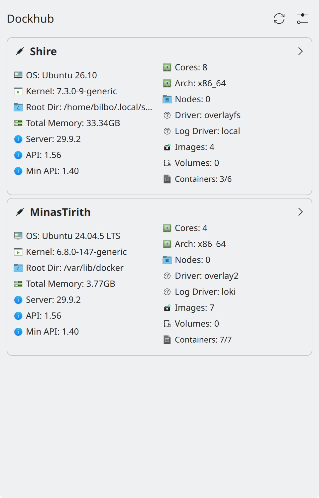
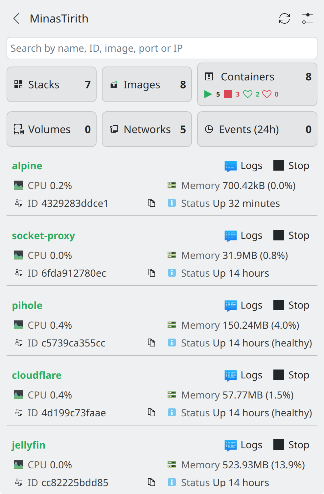
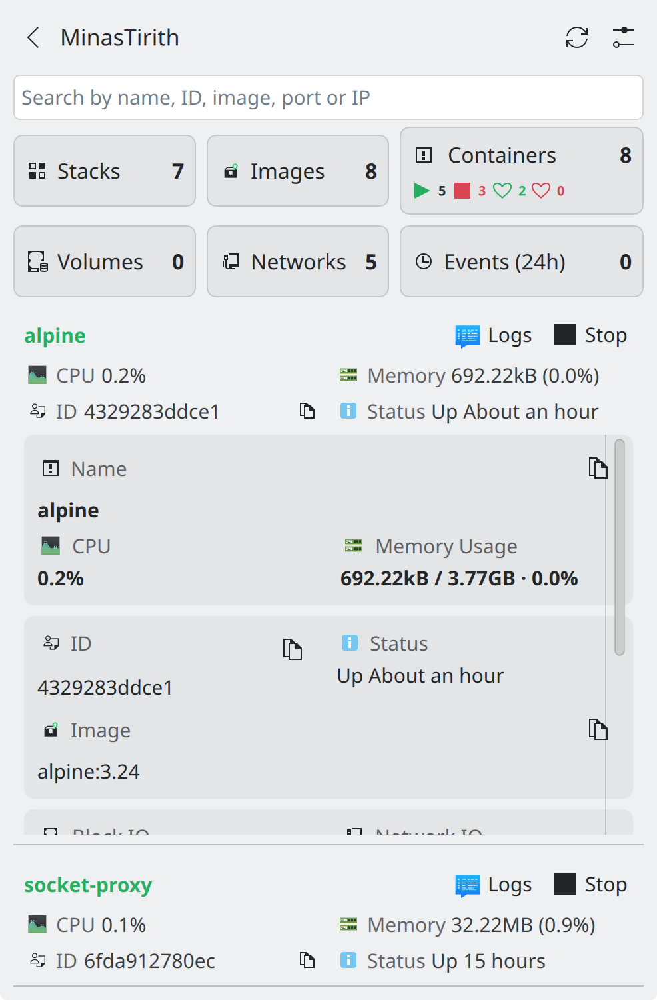
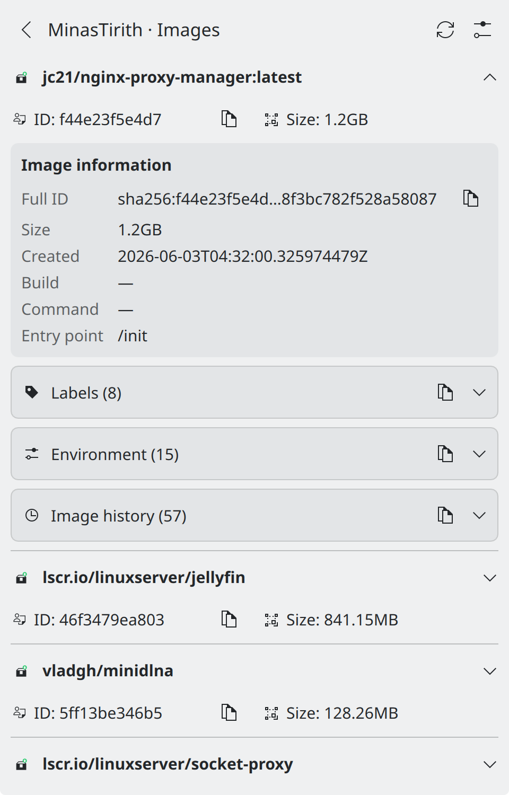

# DockHub

[DockHub](https://dockhub.opensquares.in) is a KDE Plasma applet for managing multiple Docker server instances from a single desktop dashboard. It lets you connect to local and remote Docker daemons, monitor containers, images, networks and volumes, and view Docker events directly from your desktop.

## Screenshots

<p align="center">
  
  
  
  
</p>

## Videos

### Logs Streaming

[Logs_Streaming.mp4](https://github.com/user-attachments/assets/fccd59c2-dfb3-4472-a28a-a299537ed949)

## Features

### Multi-Server Support

- Connect to multiple Docker servers across different hosts.
- Support for local rootful and rootless Docker installations.
- Support for remote Docker API endpoints.
- Support for Docker socket proxies.
- Give each server a custom name for easy identification.
- Enable or disable individual servers independently.
- Monitor server connection health (online, offline or unreachable).

### Resource Monitoring

- **Containers:** View running and stopped containers with resource statistics, including CPU, memory, block I/O and network I/O.
- **Images:** Inspect Docker images, including labels, environment information and image history.
- **Networks:** View network configurations, IPAM settings and attached containers.
- **Volumes:** Inspect Docker volumes and their associated containers.
- **Events:** Monitor Docker daemon events, including container lifecycle changes and image operations.
- **Stacks:** View Docker compose stacks with container counts and nested container lists.
- **Container Logs:** Stream and view real-time container logs with auto-follow scrolling.

### Container Actions

- Start, stop, restart, pause and unpause containers.
- Stream and view real-time container logs.
- Copy container IDs, names, port mappings and volume mappings to the clipboard.
- Search containers by name, image, port or IP address.

### Dashboard Overview

- View running and stopped container counts for each server.
- Inspect server information, including Docker version, architecture, kernel and operating system.
- View disk usage statistics.
- Monitor server health at a glance.

### Customization

- Configure the dashboard refresh interval.
- Choose which metrics appear in server overview cards.
- Configure the resource usage statistics refresh interval.
- Select which resource pages to display, including stacks, images, networks, volumes and events.
- Configure log font size for the real-time log viewer.

## Download and Installation

### Download

Get the latest stable DockHub release from GitHub:

**[Download DockHub — Latest Release](https://github.com/aaryanvangari/dockhub/releases/latest)**

Download the `.deb` package for your system from the latest release assets.

### Install

On Debian or Ubuntu-based distributions, install the downloaded package using:

```bash
sudo apt install ./dockhub_*_amd64.deb
```

After installation, open Plasma's widget browser, search for **DockHub**, and add it to your desktop or panel.

## Docker Connection Methods

DockHub supports multiple ways to connect to Docker servers.

### 1. Remote Docker API

Connect directly to a Docker Engine API endpoint over HTTP or HTTPS.

Example:

```text
http://192.168.1.100:2375
```

The Docker API must be accessible from the machine running DockHub.

### 2. Docker Socket Proxy

Connect through a Docker socket proxy instead of exposing the complete Docker Engine API.

Example:

```text
http://192.168.1.100:4375
```

A socket proxy can restrict which Docker API operations are accessible to remote clients.

### 3. Local Docker Unix Socket

DockHub supports local Docker installations through their Unix sockets.

**Rootless Docker:**

```text
/run/user/<UID>/docker.sock
```

Example:

```text
/run/user/1000/docker.sock
```

**Rootful Docker:**

```text
/var/run/docker.sock
```

Local Unix socket communication is handled by DockHub's native C++ plugin (`UnixSocketBridge`), which manages HTTP request construction, chunked-transfer decoding, and persistent streaming connections over `QLocalSocket`.

### Future Connection Methods

SSH connections and a dedicated DockHub Agent are not currently supported. They may be considered in future releases based on user requirements.

## Requirements

- KDE Plasma 6.
- Qt 6 with QtQuick/QML support.
- C++ build environment and the required Qt/KDE development dependencies for building the native plugin.
- Network connectivity to remote Docker API endpoints when connecting to remote servers.
- Appropriate permissions to access local Docker Unix sockets.

## Installation

### From KDE Store

1. Open Discover or visit the KDE Store.
2. Search for **[DockHub](https://store.kde.org/p/2381533/)**.
3. Select DockHub and install it.

### From Source

1. Clone the repository:

```bash
git clone https://github.com/aaryanvangari/dockhub.git
cd dockhub
```

2. Follow the build and installation instructions in [DEVELOPMENT.md](./DEVELOPMENT.md).

DockHub includes a native C++ QML plugin for local Unix socket communication. Make sure the native component is built and installed along with the plasmoid.

### Manual Installation

For installations that include the native plugin, follow the developer documentation to build and install the required components.

Copying only the `contents` directory is not sufficient when the native plugin has not already been installed.

## Usage

### Adding a Server

1. Right-click the DockHub applet.
2. Select **Configure DockHub**.
3. Open the **Servers** tab.
4. Click **Add Server**.
5. Configure the server:

   - **Name:** A friendly name for the server (e.g. `Production`, `Development`).
   - **Connection Type:** Select the appropriate connection method.
   - **Host URL / Socket Path:** Enter the Docker API endpoint or local Unix socket path, depending on the selected connection type.
   - **Enabled:** Enable or disable the server.

6. Save the configuration.

### Connecting to Docker

**Remote Docker API**

- Ensure the Docker API endpoint is accessible from your machine.
- Configure the appropriate HTTP or HTTPS endpoint.
- Ensure firewall rules permit the connection.

**Docker Socket Proxy**

- Configure the socket proxy on the remote Docker host.
- Provide its HTTP or HTTPS endpoint.
- Ensure the proxy allows the Docker API operations required by DockHub.

**Local Docker**

- Ensure Docker is running.
- Select the correct rootful or rootless Unix socket.
- Ensure the user running DockHub has permission to access the socket.

### Using the Dashboard

- **Server List:** View configured Docker servers, connection status and quick statistics.
- **Container List:** Browse containers and their resource statistics.
- **Resource Pages:** Explore the available Docker resources, including stacks, images, networks, volumes and events.
- **Container Actions:** Perform supported container operations directly from the applet.

## Configuration Options

### General Settings

- **Refresh Dashboard Every:** Configure the dashboard refresh interval.
- **Refresh Usage Every:** Configure how frequently resource usage statistics are updated.
- **Server Overview Columns:** Choose which metrics appear in server overview cards.
- **Server Overview Refresh Interval:** Configure the refresh interval for server overview information.
- **Show Server Images:** Control whether image information is displayed.
- **Show Server Volumes:** Control whether volume information is displayed.

### Server Settings

- **Name:** Custom display name for the server.
- **Connection Type:** Select the connection method.
- **Host URL / Socket Path:** Configure the endpoint or Unix socket path.
- **Enabled:** Enable or disable the server.

## Troubleshooting

### Server appears offline or unreachable

- Verify that the Docker daemon is running.
- Check that the configured endpoint or socket path is correct.
- Verify network connectivity to remote servers.
- Check firewall rules and proxy configuration.
- For HTTPS connections, verify the TLS configuration.

### Cannot connect to local Docker

- Check Docker service status:

```bash
systemctl status docker
```

- For rootful Docker, verify the socket exists:

```bash
ls -l /var/run/docker.sock
```

- For rootless Docker, verify the socket exists:

```bash
ls -l "$XDG_RUNTIME_DIR/docker.sock"
```

- Check that the user running DockHub has permission to access the socket.

### Cannot connect through a socket proxy

- Verify that the socket proxy is running.
- Check that the configured endpoint and port are correct.
- Ensure the proxy permits the Docker API operations DockHub requires.
- Check the proxy logs for errors.

### Cannot read container statistics

- Verify that the Docker daemon is responding correctly.
- Check whether the configured connection method permits access to the required API endpoints.
- Inspect Docker daemon and socket proxy logs for errors.

### Empty server list

- Open **Configure DockHub → Servers**.
- Add a server with a valid connection configuration.
- Ensure the server is enabled.
- Refresh the dashboard.

### Check the logs

```bash
journalctl --user -f -o cat _COMM=plasmashell | grep --line-buffered 'DockHub'
```

## License

Copyright (c) Aaryan Vangari

DockHub is licensed under the **GNU General Public License v3.0 or later**.

See [LICENSE](./LICENSE) for the full license text.

## Support and Bug Reports

For bug reports, feature requests and questions, visit the [DockHub GitHub Issues](https://github.com/aaryanvangari/dockhub/issues) page.

## Contributing

Contributions are welcome! Feel free to submit pull requests.

Issues and feature requests can be submitted through GitHub Issues.

See the [Developer Guide](./DEVELOPMENT.md) for development and build instructions.

## Credits

- Original idea and implementation by Aaryan Vangari.
- Built using the KDE Plasma Plasmoid framework.
- Uses QtQuick/QML for the user interface.
- Uses a native C++ QML plugin (`UnixSocketBridge`) for local Docker Unix socket communication and HTTP streaming.
- Integrates with the Docker Engine API.

## Links

- [KDE Plasma](https://kde.org/plasma-desktop/)
- [KDE Community](https://community.kde.org/)
- [KDE Store](https://store.kde.org/)
- [Docker Engine API Documentation](https://docs.docker.com/reference/api/engine/)
- [Docker Engine Security](https://docs.docker.com/engine/security/)
